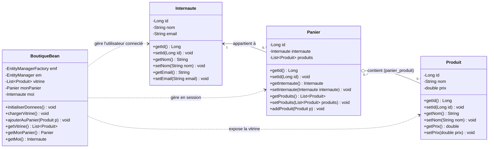
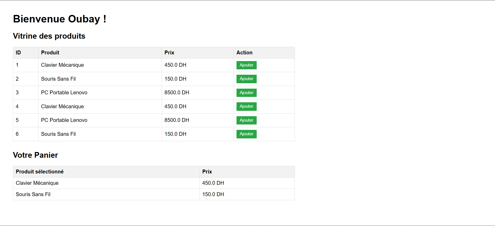

# Rapport de Projet : Application Web E-Commerce basée sur JSF et JPA

---

### **Informations Académiques**
* **Établissement :** Université Abdelmalek Essaadi – Faculté des Sciences et Techniques de Tanger (FSTT)
* **Formation :** LSI
* **Module :** JEE
* **Enseignant :** Pr. ELAACHAK LOTFI
* **Étudiant :** EL ARABI SERGHINI Oubay
* **Année Universitaire :** 2026 – 2027

---

## 1. Introduction et Objectifs de l'Atelier

Dans le cadre des travaux pratiques avancés du module **JEE**, cet atelier a pour objectif la conception et l'implémentation d'une application web simulant une boutique de commerce électronique (**E-Commerce**).

Les objectifs pédagogiques et techniques principaux sont :
1. **Maîtriser l'API JPA (*Java Persistence API*)** : modélisation du domaine métier à l'aide d'entités annotées, gestion du mapping objet-relationnel (ORM) via le fournisseur **EclipseLink**, configuration de l'unité de persistance (`persistence.xml`), et manipulation programmatique des transactions (`EntityManager`).
2. **Maîtriser le Framework JSF (*JavaServer Faces*)** : mise en œuvre de l'architecture MVC événementielle côté serveur, liaison dynamique des composants graphiques (Facelets `.xhtml`) avec des composants contrôleurs gérés (**Managed Beans** avec portée `@SessionScoped`).
3. **Génération automatique de la base de données relationnelle** sur **MySQL** à partir des définitions des entités Java (DDL automatique).
4. **Intégration complète de la chaîne logicielle** : Maven, Servlet API 4.0, Apache Tomcat, EclipseLink JPA et MySQL.

---

## 2. Architecture Globale et Structure du Projet

L'application suit scrupuleusement le patron d'architecture **MVC (Modèle - Vue - Contrôleur)** en 3 couches :

```
       [ Navigateur Web ]
               │
               ▼  (Requêtes HTTP / JSF Lifecycle)
┌──────────────────────────────────────────────┐
│  Couche Vue (Facelets - index.xhtml)         │
│  - Formulaires, Composants h:dataTable, etc. │
└──────────────────────┬───────────────────────┘
                       │ EL (Expression Language)
┌──────────────────────▼───────────────────────┐
│  Couche Contrôle (JSF Managed Bean)          │
│  - BoutiqueBean (@SessionScoped)             │
└──────────────────────┬───────────────────────┘
                       │ Transactions & CRUD (EntityManager)
┌──────────────────────▼───────────────────────┐
│  Couche Modèle & Persistance (JPA / ORM)     │
│  - Entités : Internaute, Panier, Produit     │
│  - Fournisseur : EclipseLink                 │
└──────────────────────┬───────────────────────┘
                       │ JDBC Driver
┌──────────────────────▼───────────────────────┐
│  SGBD Relationnel                            │
│  - MySQL / MariaDB (ecommerce_jsf_db)        │
└──────────────────────────────────────────────┘
```

### Arborescence du Code Source

```
EcommerceJSF/
│
├── pom.xml                                      <- Descripteur de projet Maven et gestion des dépendances
├── img/                                         <- Captures d'écran d'exécution et de validation
│   ├── image.png                                <- Vue de l'application web en fonctionnement
│   ├── image copy.png                           <- Table de jointure panier_produit dans MySQL
│   └── image copy 2.png                         <- Table produit dans MySQL
│
└── src/
    └── main/
        ├── java/
        │   └── ma/fstt/
        │       ├── bean/
        │       │   └── BoutiqueBean.java        <- Contrôleur JSF gérant la session, vitrine et panier
        │       └── model/
        │           ├── Internaute.java          <- Entité JPA représentant le client
        │           ├── Panier.java              <- Entité JPA représentant le panier d'achats
        │           └── Produit.java             <- Entité JPA représentant les articles de la vitrine
        │
        ├── resources/
        │   └── META-INF/
        │       └── persistence.xml              <- Configuration de l'unité de persistance JPA (EclipseLink)
        │
        └── webapp/
            ├── WEB-INF/
            │   └── web.xml                      <- Descripteur de déploiement (FacesServlet & Servlet 4.0)
            ├── index.xhtml                      <- Vue principale de l'application e-commerce
            └── index.jsp                        <- Page d'accueil basique
```

---

## 3. Étape 1 : Conception et Diagramme de Classes UML

Conformément à la consigne de l'étape 1, la conception est centrée sur trois axes essentiels du commerce en ligne :
* **L'Internaute (Client) :** identifié par un identifiant, un nom et une adresse email.
* **Le Panier :** rattaché à un internaute, il agrège les références des produits commandés.
* **La Vitrine & les Produits :** le catalogue des produits disponibles à l'achat, caractérisés par leur nom et leur prix unitaire.

### Diagramme de Classes UML (Mermaid)



### Analyse des Associations et Choix de Modélisation
1. **Association Internaute $\leftrightarrow$ Panier :**
   * Relation `@ManyToOne` : Un internaute peut être propriétaire de paniers d'achats successifs. Chaque panier est directement relié à un seul internaute.
2. **Association Panier $\leftrightarrow$ Produit :**
   * Relation `@ManyToMany(fetch = FetchType.EAGER)` : Un panier contient une liste de plusieurs produits, et un même produit du catalogue peut figurer dans les paniers de plusieurs utilisateurs.
   * La persistance génère ainsi automatiquement la table de liaison `panier_produit` reliant la clé primaire `Panier_ID` à la clé étrangère `produits_ID`.
   * Le chargement immédiat (`EAGER`) garantit que les éléments du panier sont disponibles pour l'affichage JSF même après la clôture de la transaction immédiate.
3. **Gestion de la Vitrine :**
   * La vitrine n'est pas une entité figée séparée, mais une vue dynamique du catalogue obtenue via la requête JPQL `SELECT p FROM Produit p` dans le Managed Bean.

---

## 4. Étape 2 : Configuration Maven et Dépendances Logicielle

L'étape 2 requiert la création d'un projet Web dynamique avec une version de module web supérieure à 3 (ici configuré en **Servlet 4.0**), converti sous **Maven** avec les bibliothèques indispensables.

### Dépendances dans le fichier `pom.xml`

Le fichier [pom.xml](file:///c:/Users/My%20ThinkBook/IdeaProjects/EcommerceJSF/pom.xml) a été paramétré avec précision :

```xml
<dependencies>
    <!-- 1. Connecteur MySQL (Base de données) -->
    <dependency>
        <groupId>mysql</groupId>
        <artifactId>mysql-connector-java</artifactId>
        <version>8.0.12</version>
    </dependency>

    <!-- 2. Implémentation EclipseLink pour JPA -->
    <dependency>
        <groupId>org.eclipse.persistence</groupId>
        <artifactId>eclipselink</artifactId>
        <version>2.7.5</version>
    </dependency>

    <!-- 3. JSF API -->
    <dependency>
        <groupId>com.sun.faces</groupId>
        <artifactId>jsf-api</artifactId>
        <version>2.2.20</version>
    </dependency>

    <!-- 4. JSF Implémentation (Mojarra) -->
    <dependency>
        <groupId>com.sun.faces</groupId>
        <artifactId>jsf-impl</artifactId>
        <version>2.2.20</version>
    </dependency>

    <!-- 5. Servlet API 4.0 (Scope provided pour Tomcat) -->
    <dependency>
        <groupId>javax.servlet</groupId>
        <artifactId>javax.servlet-api</artifactId>
        <version>4.0.0</version>
        <scope>provided</scope>
    </dependency>
</dependencies>
```

### Configuration du Contrôleur dans `web.xml`

Le descripteur de déploiement [web.xml](file:///c:/Users/My%20ThinkBook/IdeaProjects/EcommerceJSF/src/main/webapp/WEB-INF/web.xml) déclare le `FacesServlet`, point d'entrée unique de la machine d'état JSF :

```xml
<web-app xmlns="http://xmlns.jcp.org/xml/ns/javaee"
         xmlns:xsi="http://www.w3.org/2001/XMLSchema-instance"
         xsi:schemaLocation="http://xmlns.jcp.org/xml/ns/javaee http://xmlns.jcp.org/xml/ns/javaee/web-app_4_0.xsd"
         version="4.0">

    <servlet>
        <servlet-name>Faces Servlet</servlet-name>
        <servlet-class>javax.faces.webapp.FacesServlet</servlet-class>
        <load-on-startup>1</load-on-startup>
    </servlet>

    <servlet-mapping>
        <servlet-name>Faces Servlet</servlet-name>
        <url-pattern>*.xhtml</url-pattern>
    </servlet-mapping>

    <welcome-file-list>
        <welcome-file>index.xhtml</welcome-file>
    </welcome-file-list>
</web-app>
```

---

## 5. Étape 3 : Couche Modèle et Persistance JPA

### Configuration de l'Unité de Persistance : `persistence.xml`

Le fichier [persistence.xml](file:///c:/Users/My%20ThinkBook/IdeaProjects/EcommerceJSF/src/main/resources/META-INF/persistence.xml) définit l'unité de persistance nommée `EcommercePU` avec transaction locale (`RESOURCE_LOCAL`) pour un déploiement sur conteneur léger de servlets (Apache Tomcat) :

```xml
<?xml version="1.0" encoding="UTF-8"?>
<persistence version="2.0" xmlns="http://java.sun.com/xml/ns/persistence"
             xmlns:xsi="http://www.w3.org/2001/XMLSchema-instance"
             xsi:schemaLocation="http://java.sun.com/xml/ns/persistence http://java.sun.com/xml/ns/persistence/persistence_2_0.xsd">

    <persistence-unit name="EcommercePU" transaction-type="RESOURCE_LOCAL">
        <provider>org.eclipse.persistence.jpa.PersistenceProvider</provider>

        <!-- Déclaration des entités gérées -->
        <class>ma.fstt.model.Internaute</class>
        <class>ma.fstt.model.Produit</class>
        <class>ma.fstt.model.Panier</class>

        <properties>
            <!-- Paramètres de connexion MySQL -->
            <property name="javax.persistence.jdbc.driver" value="com.mysql.cj.jdbc.Driver"/>
            <property name="javax.persistence.jdbc.url" value="jdbc:mysql://localhost:3306/ecommerce_jsf_db?serverTimezone=UTC"/>
            <property name="javax.persistence.jdbc.user" value="root"/>
            <property name="javax.persistence.jdbc.password" value=""/>

            <!-- Génération automatique du schéma SQL -->
            <property name="eclipselink.ddl-generation" value="drop-and-create-tables"/>
            <property name="eclipselink.logging.level" value="INFO"/>
        </properties>
    </persistence-unit>
</persistence>
```

### Détail des Entités Métier

1. **`Internaute` :** Représente l'utilisateur du site. Clé primaire auto-générée (`@GeneratedValue(strategy = GenerationType.IDENTITY)`), nom et email.
2. **`Produit` :** Représente un article vendu en boutique avec désignation et prix unitaire.
3. **`Panier` :** Entité d'agrégation. Elle maintient la relation ManyToOne avec `Internaute` et ManyToMany avec `Produit`, offrant la méthode métier `addProduit(Produit p)`.

### Validation et Preuve de Génération de la Base de Données (MySQL)

Lors de l'initialisation du `EntityManagerFactory`, EclipseLink interprète les annotations JPA et génère automatiquement le schéma relationnel dans la base MySQL `ecommerce_jsf_db`.

#### Table `produit` dans MySQL (phpMyAdmin)
Les articles du catalogue y sont insérés avec leur identifiant, leur nom et leur prix unitaire.

<div align="center">
  
  <p><strong>Figure 1 :</strong> Visualisation de la table <code>produit</code> générée automatiquement dans MySQL (via phpMyAdmin).</p>
</div>

#### Table de jointure `panier_produit` dans MySQL (phpMyAdmin)
La relation n-n entre `Panier` et `Produit` est matérialisée par la table intermédiaire `panier_produit`, stockant les associations entre le panier courant (`Panier_ID = 2`) et les produits sélectionnés (`produits_ID = 1` et `2`).

<div align="center">
  
  <p><strong>Figure 2 :</strong> Table de jointure <code>panier_produit</code> confirmant le bon fonctionnement de la relation <code>@ManyToMany</code> JPA.</p>
</div>

---

## 6. Étape 4 : Couche Présentation et Contrôle JSF

### Le Managed Bean : `BoutiqueBean`

La classe [BoutiqueBean.java](file:///c:/Users/My%20ThinkBook/IdeaProjects/EcommerceJSF/src/main/java/ma/fstt/bean/BoutiqueBean.java) agit comme contrôleur applicatif. Elle est annotée avec `@ManagedBean(name = "boutiqueBean")` et `@SessionScoped`, ce qui lui permet de conserver l'état du panier tout au long de la session de navigation de l'utilisateur.

```java
@ManagedBean(name = "boutiqueBean")
@SessionScoped
public class BoutiqueBean implements Serializable {
    private EntityManagerFactory emf;
    private EntityManager em;

    private List<Produit> vitrine;
    private Panier monPanier;
    private Internaute moi;

    public BoutiqueBean() {
        emf = Persistence.createEntityManagerFactory("EcommercePU");
        em = emf.createEntityManager();

        initialiserDonnees();
        chargerVitrine();
    }

    private void initialiserDonnees() {
        em.getTransaction().begin();
        moi = new Internaute();
        moi.setNom("Oubay");
        moi.setEmail("oubay@fstt.ma");
        em.persist(moi);

        monPanier = new Panier();
        monPanier.setInternaute(moi);
        em.persist(monPanier);

        em.persist(new Produit("PC Portable Lenovo", 8500.0));
        em.persist(new Produit("Souris Sans Fil", 150.0));
        em.persist(new Produit("Clavier Mécanique", 450.0));
        em.getTransaction().commit();
    }

    private void chargerVitrine() {
        vitrine = em.createQuery("SELECT p FROM Produit p", Produit.class).getResultList();
    }

    public void ajouterAuPanier(Produit p) {
        em.getTransaction().begin();
        monPanier.addProduit(p); // Ajout en mémoire
        em.merge(monPanier);     // Synchronisation JPA en base
        em.getTransaction().commit();
    }

    // Getters exposés à JSF EL
    public List<Produit> getVitrine() { return vitrine; }
    public Panier getMonPanier() { return monPanier; }
    public Internaute getMoi() { return moi; }
}
```

### La Vue Facelets : `index.xhtml`

L'interface [index.xhtml](file:///c:/Users/My%20ThinkBook/IdeaProjects/EcommerceJSF/src/main/webapp/index.xhtml) utilise les composants standard de la bibliothèque de balises HTML JSF (`xmlns:h="http://xmlns.jcp.org/jsf/html"` et `xmlns:f="http://xmlns.jcp.org/jsf/core"`).

Elle offre une navigation claire en deux sections :
1. **La Vitrine :** Un tableau `<h:dataTable>` itérant sur `#{boutiqueBean.vitrine}` affichant les détails de chaque article et un bouton d'action `<h:commandButton action="#{boutiqueBean.ajouterAuPanier(prod)}">`.
2. **Le Panier :** Un second tableau affichant en temps réel les produits contenus dans `#{boutiqueBean.monPanier.produits}`.

```xml
<!DOCTYPE html>
<html xmlns="http://www.w3.org/1999/xhtml"
      xmlns:h="http://xmlns.jcp.org/jsf/html"
      xmlns:f="http://xmlns.jcp.org/jsf/core">
<h:head>
    <title>Boutique E-commerce JSF</title>
    <style>
        body { font-family: Arial, sans-serif; margin: 40px; }
        table { border-collapse: collapse; width: 60%; margin-bottom: 30px; }
        th, td { border: 1px solid #ddd; padding: 8px; text-align: left; }
        th { background-color: #f2f2f2; }
        .btn { padding: 5px 10px; background-color: #28a745; color: white; border: none; cursor: pointer; }
        .btn:hover { background-color: #218838; }
    </style>
</h:head>
<h:body>
    <h1>Bienvenue #{boutiqueBean.moi.nom} !</h1>

    <h2>Vitrine des produits</h2>
    <h:form>
        <h:dataTable value="#{boutiqueBean.vitrine}" var="prod">
            <h:column><f:facet name="header">ID</f:facet>#{prod.id}</h:column>
            <h:column><f:facet name="header">Produit</f:facet>#{prod.nom}</h:column>
            <h:column><f:facet name="header">Prix</f:facet>#{prod.prix} DH</h:column>
            <h:column>
                <f:facet name="header">Action</f:facet>
                <h:commandButton value="Ajouter" action="#{boutiqueBean.ajouterAuPanier(prod)}" styleClass="btn"/>
            </h:column>
        </h:dataTable>
    </h:form>

    <h2>Votre Panier</h2>
    <h:dataTable value="#{boutiqueBean.monPanier.produits}" var="pPanier">
        <h:column><f:facet name="header">Produit sélectionné</f:facet>#{pPanier.nom}</h:column>
        <h:column><f:facet name="header">Prix</f:facet>#{pPanier.prix} DH</h:column>
    </h:dataTable>
</h:body>
</html>
```

### Preuve d'Exécution de l'Application Web

Lors de l'accès au site, l'internaute est accueilli par son nom dynamique (*"Bienvenue Oubay !"*). L'utilisateur peut ajouter des produits de la vitrine directement dans son panier par un simple clic sur *"Ajouter"*, ce qui déclenche l'événement serveur JSF, persiste la sélection dans la base de données via JPA, et rafraîchit la vue.

<div align="center">
  
  <p><strong>Figure 3 :</strong> Interface graphique de l'application e-commerce en cours d'exécution dans le navigateur.</p>
</div>